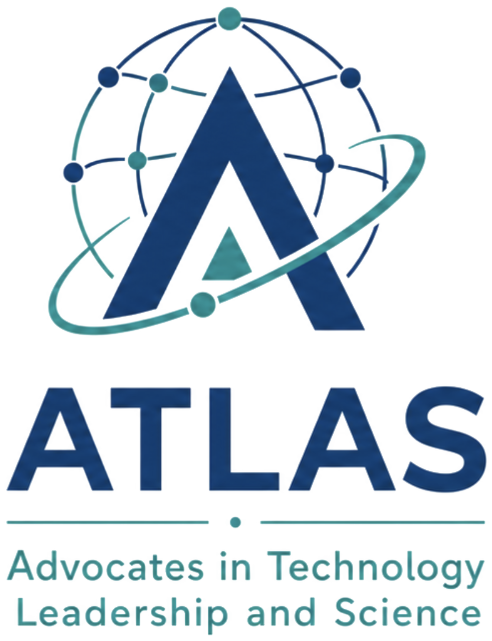

<div class="about-intro">

<div>
<div class="section-label" style="margin-top:0">Our mission</div>
<p class="big">ATLAS (Advocates in Technology, Leadership, and Science) gives high school and undergraduate students a serious path into research. We believe students can do meaningful quantitative work early in their education when they get rigorous training, close mentorship, and a real question to answer.</p>
</div>
</div>

<div class="section-label">How the program works</div>

## Six steps from curiosity to impact

<div class="steps">
<div class="card step"><span class="num">1</span><h4>Question</h4>Each student or team develops a focused research question in medicine, AI, or public health, usually framed with PICO criteria.</div>
<div class="card step"><span class="num">2</span><h4>Training</h4>Students learn the statistical methods their question requires, from two by two tables to random effects meta-analysis and model discrimination.</div>
<div class="card step"><span class="num">3</span><h4>Evidence</h4>Teams search the literature, screen studies, extract data, and run their analyses.</div>
<div class="card step"><span class="num">4</span><h4>Equity</h4>Every project examines access barriers and underserved populations.</div>
<div class="card step"><span class="num">5</span><h4>Presentation</h4>Students submit abstracts and present posters and talks at academic conferences.</div>
<div class="card step"><span class="num">6</span><h4>Advocacy</h4>Students translate findings into briefs and real world tools for health officials and communities.</div>
</div>

<div class="section-label">Leadership</div>

## Our founder

```{r, echo = FALSE, results = "asis"}
if (file.exists("images/people/janvi.jpg")) cat('')
```

<div class="card">
<h4>Janvi Garg, Founder and Director</h4>
Janvi founded ATLAS and serves as its director. She is a Master of Science student in Biostatistics (Public Health Data Science) at Columbia University and holds a BS in Biology and Mathematics from Baylor University. She is also a certified EMT. She personally trains ATLAS students in applied biostatistics, mentors each project from question to conference, and serves as the liaison between ATLAS advocacy teams and public health partners.
</div>

<div class="section-label">Partners</div>

## Working with public health

ATLAS can work with health departments, clinics, hospitals, and community organizations anywhere in the United States. Our teams support goals on screenable cancers, cardiovascular disease, diabetes, and health equity, and we welcome new public health partners.
