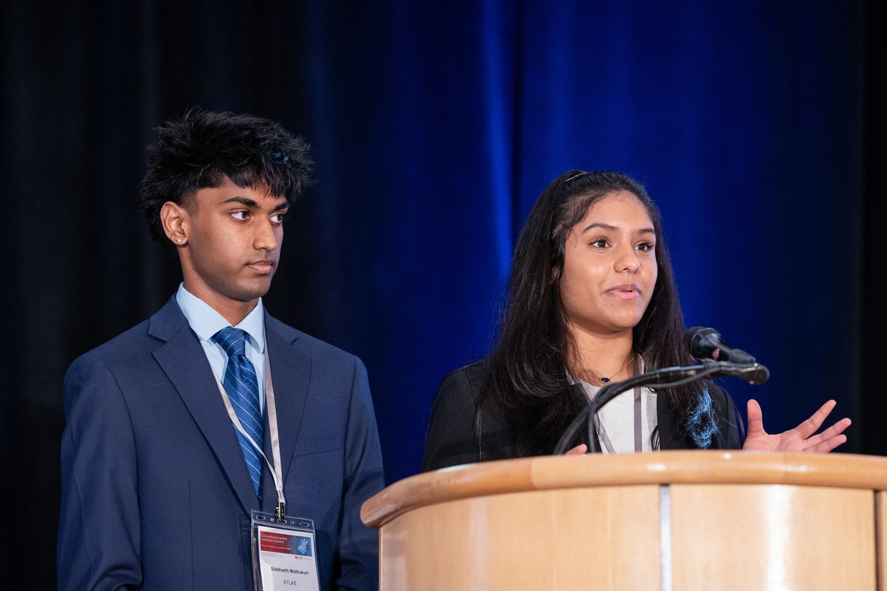

Advocates in Technology, Leadership, and Science

<h1>Real research. Real impact. Starting now.</h1>

ATLAS is a research mentorship program empowering future scientists through quantitative medicine, AI, and public health.

<a class="btn-atlas" href="research.html">Explore our research</a>
<a class="btn-atlas-outline" href="join.html">Join ATLAS</a>

<strong>25</strong>student researchers

<strong>6</strong>research projects

<strong>5</strong>conferences presented

<strong>2</strong>advocacy projects

Who we are

## Training the next generation of health researchers

ATLAS trains high school and undergraduate students to do real biomedical and public health research. Students learn graduate-level biostatistics, synthesize published evidence, analyze data, and present their findings at national and international conferences. Then they put those skills to work building tools for disease prevention, early diagnosis, and better access to care.

<figure class="feature-photo">

<figcaption>Siddharth Mothukuri and Rithvika Venkatraman giving an oral presentation at the Stanford Lean Healthcare conference.</figcaption>
</figure>

What we do

## From question to conference to community

<i class="fa fa-chart-line"></i>

<h4>Research training</h4>
Students learn R and Python, ROC and AUC analysis, predictive values, risk and hazard ratios, nonparametric testing, and meta-analytic pooling, all applied to their own research questions.

<i class="fa fa-book-open"></i>

<h4>Evidence synthesis</h4>
Teams carry out systematic reviews, meta-analyses, and scoping reviews on cancer, cardiovascular disease, neurological disease, and AI in medicine.

<i class="fa fa-balance-scale"></i>

<h4>Health equity and advocacy</h4>
Every project asks who is left behind. Students turn their evidence into policy briefs and practical tools for public health decision makers.

<i class="fa fa-microphone"></i>

<h4>Research communication</h4>
Students build posters and oral presentations and present at conferences hosted by Harvard, Stanford, the University of Pennsylvania, and the Mathematical Association of America.

<h3>See our students in action</h3>

Browse conference photos and the full list of presentations.

<a class="btn-atlas" href="presentations.html">View presentations</a>

